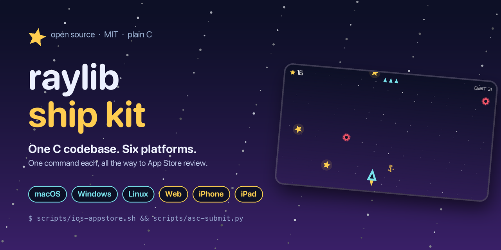
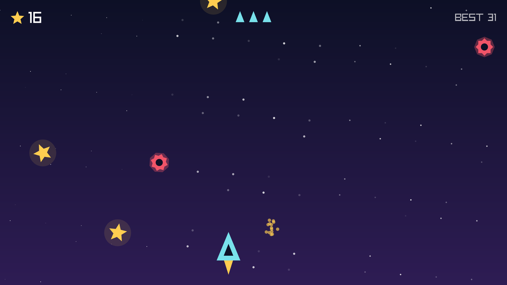
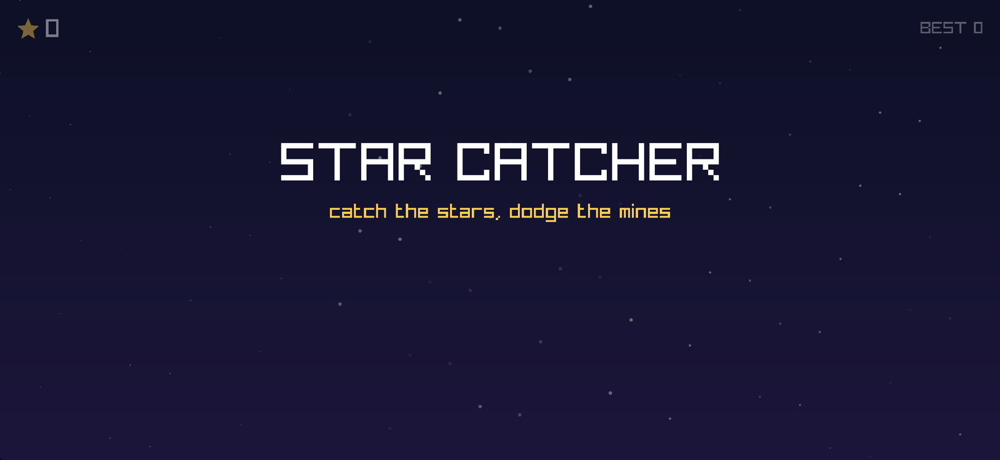
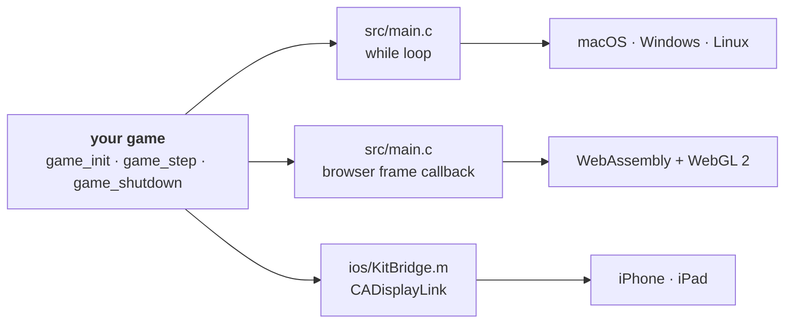

<div align="center">



# raylib ship kit

**Write your game in C with [raylib](https://www.raylib.com). Ship it to six platforms with one command each.**

macOS · Windows · Linux · Browser · iPhone · iPad, and all the way into App Store review.

### [▶ Play the demo in your browser](https://binrick.github.io/raylib-ship-kit/)

[](https://github.com/binRick/raylib-ship-kit/actions/workflows/build.yml)


</div>

---

raylib makes writing a game easy. Getting that game onto a phone, into a browser tab and past
a notarization check is where the weekends go. This kit is the build and release plumbing,
already done, with a small working game on top so you can see every target run before you
change a line.

```bash
git clone https://github.com/binRick/raylib-ship-kit.git my-game && cd my-game
./run.sh                      # plays on your Mac or Linux box in about a minute
scripts/build-web.sh --serve  # the same game in your browser
scripts/ios-sim.sh            # the same game in the iOS simulator
```

<div align="center">


<sub>Star Catcher, the bundled demo. About 200 lines of C, no engine, and it runs everywhere below.</sub>
</div>

## What you get

| Target | Command | You end up with | Needs |
|---|---|---|---|
| **macOS / Linux dev** | `./run.sh` | a running game | cmake, a C compiler |
| **Browser** | `scripts/build-web.sh` | `dist/web/` (static files: host anywhere) | emscripten |
| **Windows** | `scripts/build-windows.sh` | `dist/<game>-windows.zip`, one static `.exe` with icon, version info and DPI manifest | mingw-w64 (cross-compiles from macOS or Linux) |
| **Linux** | `scripts/build-linux.sh` | `dist/<game>-linux-<arch>.tar.gz` | Linux, or the bundled GitHub Actions workflow |
| **macOS release** | `scripts/mac-release.sh` | `dist/<game>-macos.zip`: universal `.app`, Developer ID signed, notarized, stapled | Apple Developer account (`--adhoc` needs none) |
| **iOS simulator** | `scripts/ios-sim.sh` | the game running in a simulator | Xcode, xcodegen |
| **iPhone / iPad** | `scripts/ios-device.sh` | the game on the device in your hand | a free Apple ID is enough |
| **App Store** | `scripts/ios-appstore.sh` then `scripts/asc-submit.py` | a build uploaded and **submitted for review**, without opening the website | Apple Developer account + API key |

<div align="center">


<sub>Same source, iPhone simulator. No Xcode project is checked in: it is generated.</sub>
</div>

## How it works

Your game implements three functions. Everything else drives them.

```c
#include "kit.h"

void game_init(int argc, char **argv);   // InitWindow, load assets
void game_step(void);                    // exactly one frame: update + draw
void game_shutdown(void);                // unload, CloseWindow
```



A desktop game owns its `while (!WindowShouldClose())` loop. A browser and an iPhone do not let
you: they call *you* once per frame. Splitting the loop body into `game_step()` is the one
structural change the kit asks for, and it is what lets a single codebase run on all of them.

Two helpers cover the rest of what differs per platform:

```c
kit_init();                                   // makes "assets/..." resolve everywhere
SaveFileText(kit_save_path("best.txt"), s);   // a writable place on every platform
kit_save_flush();                             // (browser: persist to IndexedDB)
```

| | Assets are read from | Saves go to |
|---|---|---|
| macOS | `Contents/Resources/assets` | `~/Library/Application Support/<Name>` |
| Windows | `assets\` beside the `.exe` | `%APPDATA%\<Name>` |
| Linux | `assets/` beside the binary | `$XDG_DATA_HOME/<Name>` |
| Browser | packed into `index.data` | IndexedDB, survives reloads |
| iOS | inside the app bundle | the app's Documents folder |

## Make it yours

One file names your game everywhere: window title, `.app`, `.exe` version info, bundle id,
Xcode project, App Store lookup.

```bash
# kit.env
APP_NAME="Star Catcher"
APP_SLUG="starcatcher"
BUNDLE_ID="com.example.starcatcher"
APP_CATEGORY="public.app-category.arcade-games"
RAYLIB_TAG="6.2"
```

Then:

1. Edit `kit.env` and `VERSION`.
2. Replace `src/game.c` with your game (add as many `.c` files to `src/` as you like: they are picked up automatically).
3. Put your files in `assets/`. Replace `assets/icon.png` with a 1024px square: every platform's icon is cut from it.

## The iOS part

raylib has no official iOS backend. The kit carries a small one (`ios/rcore_ios.c`, about 400
lines) plus an Objective-C shell, and patches a fresh raylib checkout at build time, so you
stay on stock upstream raylib and can bump `RAYLIB_TAG` when a new release lands.

```bash
scripts/ios-sim.sh                                   # simulator: no account, no cable
TEAM_ID=ABCDE12345 scripts/ios-device.sh             # your own phone
TEAM_ID=ABCDE12345 ASC_KEY_ID=... ASC_ISSUER_ID=... scripts/ios-appstore.sh
scripts/asc-submit.py "Faster loading and two new levels."   # → Waiting for Review
```

`asc-submit.py` talks to the App Store Connect API: it waits for Apple to finish processing
the upload, creates the version, attaches the build, copies your listing text forward from
the previous version, answers export compliance and submits. The first version of a new app
still needs its listing and screenshots entered on the website once.

## Traps this kit has already fallen into

Each of these cost real debugging time in a real game. They are fixed here, with a comment at
the spot explaining why.

- **A quick tap does nothing on iOS.** A touch that starts and ends between two frames is never seen as "pressed". The release is held back one frame.
- **The second finger is ignored.** UIKit reuses `UITouch` objects at the same address, so pointer-based touch ids collide. Each touch gets its own id.
- **Black screen after a render texture.** raylib returns to framebuffer `0`; on iOS the screen is not `0`.
- **Instant crash at launch on the iOS 27 SDK.** Apps that create their window in the app delegate now trap. The kit uses a scene delegate.
- **Swipes near the screen edge open Control Centre.** System gestures are deferred.
- **A trackpad tap is missed in the browser.** Same one-frame problem as iOS; the page shell delays the release by 50 ms.
- **No sound in the browser until a click.** A first key press unlocks audio too.
- **`emcc` refuses to start on macOS.** Xcode's Python 3.9 shadows the one Homebrew's emscripten needs. `build-web.sh` picks the right one.
- **Saves vanish on reload in the browser.** The save folder is mounted on IndexedDB before the game starts.
- **Screenshots come out four times too big on a Retina Mac.** The demo's `--shot` reads the framebuffer directly.
- **Windows asks for a missing DLL / blurs the window / breaks on `C:\Users\Jörg`.** Static link, per-monitor DPI manifest, UTF-8 code page.
- **App Store upload rejected for the icon.** `scripts/gen-assets.py` writes the 1024px icon without an alpha channel.

## Use it with Claude Code

The repo ships an [agent skill](skills/shipping-raylib-games/SKILL.md) that teaches Claude Code
how the kit is put together: how to port an existing raylib game onto it, which script builds
which target, and what each failure message means.

```bash
scripts/install-skill.sh      # links it into ~/.claude/skills/
```

Then, in any raylib project:

> *"Port this game onto the ship kit and get it running in the iOS simulator."*

## CI

`.github/workflows/build.yml` builds the Linux, Windows and browser versions on every push
and publishes the browser build to GitHub Pages from `main`, so every commit has a playable
link. macOS and iOS builds need a Mac; run those scripts locally or on a macOS runner.

## What has actually been run

Honesty table for this repository at its first commit (macOS 26, Apple Silicon, Xcode 27.2, raylib 6.2):

| Path | Status |
|---|---|
| macOS build, run, universal `.app` (`--adhoc`) | ✅ built and launched |
| Browser build | ✅ played in Chrome: input, canvas resize, high score persists across reload |
| iOS simulator | ✅ built, installed, launched, rendered |
| Windows cross-compile | ✅ builds and zips; the `.exe` has not been run on Windows from this repo |
| Linux build and package, Windows cross-compile, browser build, Pages deploy on GitHub Actions | ✅ green on `main` |
| Developer ID notarization, device install, App Store upload and submit | ⏳ these scripts were lifted from the release scripts of shipped raylib games and generalised; the generalised versions have not been run against Apple from this repo yet |

If one of the ⏳ rows fails for you, please open an issue with the output.

## Layout

```
kit.env                 names and ids: the one file you edit
VERSION                 the version every platform reports
src/game.c              the demo game: replace it
src/kit.{h,c}           assets + save paths per platform
src/main.c              desktop loop and browser entry
web/shell.html          the page around the browser build
ios/                    raylib iOS backend, UIKit shell, xcodegen project
macos/ windows/ cmake/  Info.plist, .rc + manifest, mingw toolchain
scripts/                one script per target
skills/                 the Claude Code skill
```

## The family

Small, separate pieces for shipping raylib games. Use one or all of them.

| | |
|---|---|
| **raylib-ship-kit** (this repo) | Build and release one C codebase to macOS, Windows, Linux, browser and iOS |
| [raylib-canvas-kit](https://github.com/binRick/raylib-canvas-kit) | One fixed resolution at any window size |
| [raylib-touch-kit](https://github.com/binRick/raylib-touch-kit) | On-screen analog stick and buttons, for when the game is on a phone |
| [raylib-debug-kit](https://github.com/binRick/raylib-debug-kit) | JSON event log, screenshots, repeatable runs, overlay |
| [raylib-dev-kit](https://github.com/binRick/raylib-dev-kit) | Sound board, asset gallery and sandboxes inside the game |

## FAQ

**Is this an engine?** No. It is raylib, unmodified on desktop and web, plus build scripts. Your game code is plain raylib.

**C++?** Add `CXX` to `project()` in `CMakeLists.txt` and `*.cpp` to the glob and the Xcode sources. The three entry points need `extern "C"`.

**Android?** Not yet. raylib supports it upstream; a `scripts/android.sh` would be a welcome contribution.

**Why OpenGL ES on iOS when Apple deprecated it?** It still ships, still passes review, and it is what raylib speaks. When raylib grows another backend the bridge is the only file that changes.

## License

[MIT](LICENSE). raylib is zlib-licensed and is fetched at build time, not vendored.

<div align="center">

If this saved you a weekend, a ⭐ helps other raylib developers find it.

</div>
